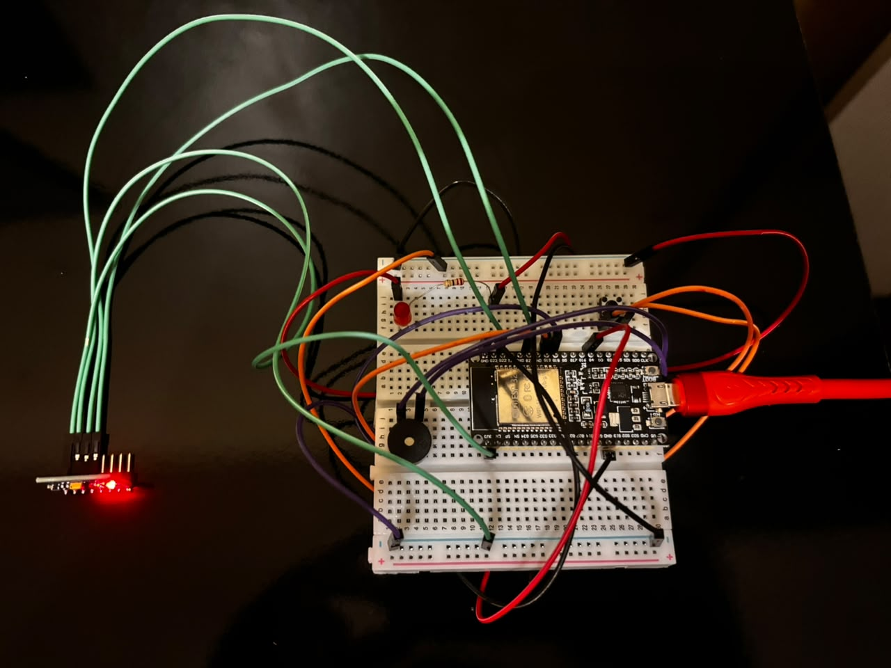
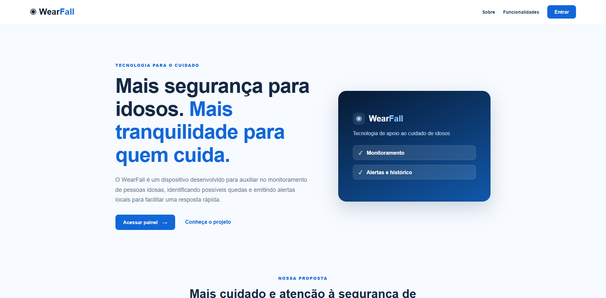
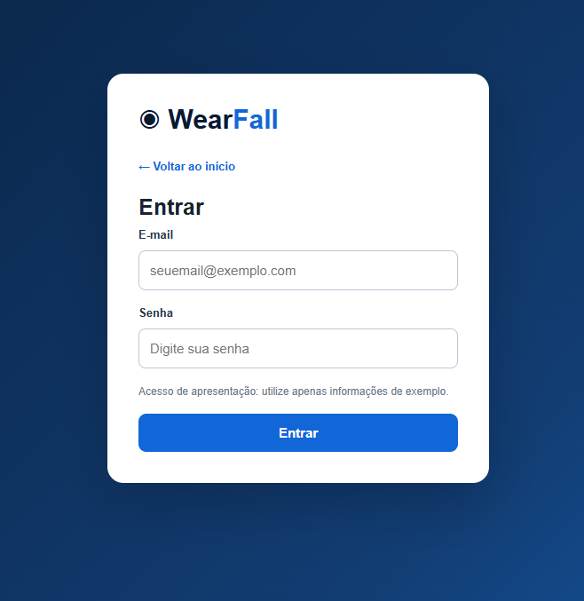
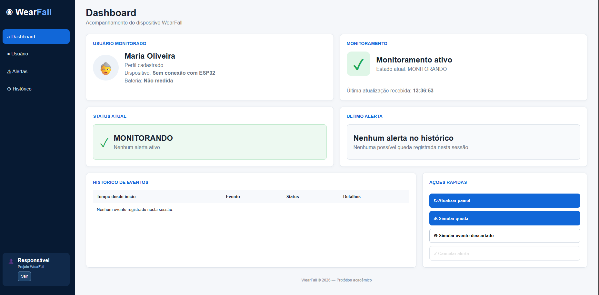

# 🛡️ WearFall

<div align="center">

**Sistema inteligente de detecção de quedas com ESP32 e sensor inercial.**

[](https://www.espressif.com/en/products/socs/esp32)
[](https://www.arduino.cc/en/software)
[](https://isocpp.org/)

[](https://github.com/CAIOanx/WearFall/stargazers)
[](https://github.com/CAIOanx/WearFall/forks)

[**Site demonstrativo**](https://caioanx.github.io/WearFall-Dashboard-Online/) · [**Código**](firmware/Wearfall/Wearfall.ino) · [**Montagem**](docs/README.md) · [**Testes**](testes/README.md) · [**Reportar problema**](https://github.com/CAIOanx/WearFall/issues)

</div>

---

## 📋 Sobre o Projeto

O **WearFall** é um protótipo acadêmico voltado a apoiar o cuidado e a segurança de **pessoas idosas**. Usa um ESP32 e um sensor inercial para identificar eventos compatíveis com quedas. Em vez de considerar somente o impacto, o algoritmo analisa **queda livre, impacto, rotação, postura após o impacto e imobilidade**. A proposta é contribuir para soluções de monitoramento, ainda em fase de validação.

### ✨ Principais Funcionalidades

- 🎯 **Detecção em etapas:** análise temporal de sinais do acelerômetro e do giroscópio.
- ⚡ **Alerta local:** LED e buzzer quando um evento é confirmado.
- 🛑 **Cancelamento:** botão físico para interromper o alerta.
- 💾 **Histórico persistente:** até dez eventos salvos usando Preferences/NVS.
- 📶 **Rede própria:** ESP32 configurado como Access Point (`WearFall_AP`), sem depender de roteador.
- 🖥️ **Painel web local:** consulta a status e eventos pelo navegador.

---

## 🎬 Demonstração

### 🧰 Montagem física do protótipo

<div align="center">
  
</div>

### 🎥 Vídeo de apresentação do protótipo

📌 **[Assistir à demonstração do WearFall no Google Drive](https://drive.google.com/file/d/1UXA2w0l-CHPcZaSeEzMucnGMQJVu-tlR/view?usp=sharing)**

A gravação apresenta o circuito do projeto. Trata-se de um registro de protótipo acadêmico em bancada, não de validação em quedas reais.

### 🖥️ Telas do projeto

**Página inicial — proposta de cuidado e acompanhamento de pessoas idosas**



**Tela de entrada — visualização do acesso ao painel**

<div align="center">
  
</div>

**Dashboard — monitoramento, alertas e histórico**



> Imagens de página inicial, login e dashboard acima. O painel **local** do ESP32, acessível em **http://192.168.4.1** quando conectado à rede `WearFall_AP`, exibe os dados do dispositivo.

**Acesso público à apresentação:** [Abrir site demonstrativo do WearFall](https://caioanx.github.io/WearFall-Dashboard-Online/). O código da interface está em [WearFall-Dashboard-Online](https://github.com/CAIOanx/WearFall-Dashboard-Online).

---

## 🛠️ Tecnologias Utilizadas

### Firmware e hardware

- **ESP32** e **Arduino IDE** (C++).
- Sensor inercial com leitura direta dos registradores por **I²C / Wire**.
- **FreeRTOS** para tarefas de amostragem, processamento e controle.
- **Preferences/NVS** para persistência dos eventos.
- **WiFi** e **WebServer** para o painel local.
- LED, buzzer e botão físico.

### Interface

- **HTML, CSS e JavaScript**, incorporados ao firmware pelo arquivo `dashboard_assets.h`.
- A versão web de apresentação está no [site demonstrativo](https://caioanx.github.io/WearFall-Dashboard-Online/), com código separado no [repositório WearFall-Dashboard-Online](https://github.com/CAIOanx/WearFall-Dashboard-Online).

---

## 🚀 Começando

### 📦 Pré-requisitos

- Uma placa **ESP32 Dev Module** e um cabo USB de dados.
- [Arduino IDE](https://www.arduino.cc/en/software).
- Pacote de placas **esp32 by Espressif Systems**.
- Componentes e ligações descritos na [documentação de montagem](docs/README.md).

### 💻 Instalação

1. Instale e abra o **Arduino IDE**.
2. Em **Arquivo → Preferências**, adicione a URL:
   ```text
   https://espressif.github.io/arduino-esp32/package_esp32_index.json
   ```
3. No **Gerenciador de Placas**, instale **esp32 by Espressif Systems**.
4. Conecte a placa via USB e selecione **ESP32 Dev Module** e a porta correspondente.
5. Abra [`firmware/Wearfall/Wearfall.ino`](firmware/Wearfall/Wearfall.ino) no Arduino IDE. Mantenha o arquivo **`dashboard_assets.h` na mesma pasta**.
6. Clique em **Upload** e, depois, abra o **Monitor Serial em 115200 baud**.

### 🌐 Acesso ao painel

1. Com o ESP32 ligado e o firmware carregado, conecte o celular/notebook à rede **`WearFall_AP`**.
2. Consulte a senha definida em `AP_SENHA` no código.
3. Acesse **http://192.168.4.1** no navegador.

O sensor é lido diretamente por I²C; **não é necessário instalar a biblioteca Adafruit_MPU6050** para este firmware. O módulo físico usado nos testes apresentou `WHO_AM_I = 0x72`, portanto a identificação exata do componente ainda merece verificação.

---

## 📖 Como Usar

O ESP32 começa no estado `MONITORANDO`. Uma sequência compatível com queda inicia a análise; se os critérios são confirmados, o dispositivo entra em `ALERTA`, acende o LED e toca o buzzer. O botão físico cancela o alerta.

Para consultar o histórico pelo **Monitor Serial**, use `H`. Para limpar os eventos salvos, use `L`. A interface web também permite acompanhar o sistema.

### Critérios experimentais da versão de bancada

| Verificação | Parâmetro utilizado |
| --- | --- |
| Queda livre | magnitude abaixo de 0,6 g |
| Impacto | acima de 2,5 g, em até 3 s |
| Rotação | acima de 150 °/s |
| Postura alterada | \|Az\| abaixo de 0,5 g por 800 ms |
| Imobilidade aproximada | magnitude entre 0,85 e 1,15 g por 800 ms |
| Janela pós-impacto | 6 s |

**Atenção:** esses parâmetros são experimentais. Os testes de bancada não comprovam precisão ou confiabilidade em quedas reais.

---

## 📋 Funcionalidades Detalhadas

### 🧭 Monitoramento pelo ESP32

- O sensor inercial fornece leituras de aceleração e rotação para análise no ESP32.
- O algoritmo verifica uma sequência experimental de indícios: queda livre, impacto, rotação, mudança de postura e imobilidade aproximada.
- Quando os critérios definidos são atendidos, o sistema entra no estado `ALERTA`. Quando não são confirmados, a ocorrência pode ser descartada.
- O objetivo é sinalizar **possíveis quedas**; ainda não há comprovação de precisão para uso como dispositivo de segurança pessoal.

### 🚨 Alertas e cancelamento

- Em uma ocorrência confirmada pelo algoritmo, o ESP32 aciona o **LED** e o **buzzer** locais.
- O alerta pode ser cancelado pelo **botão físico** do protótipo.
- A dashboard local também oferece um botão para solicitar o cancelamento ao próprio ESP32 quando houver um alerta ativo.

### 💾 Histórico de eventos

- O firmware registra eventos com informações da análise e sua classificação.
- O histórico mantém até **dez registros**, com persistência por `Preferences/NVS` para recuperação após reinicialização, quando o armazenamento está disponível.
- O histórico pode ser consultado no painel local e pelo Monitor Serial.

### 📶 Dashboard local do dispositivo

- O ESP32 cria a rede Wi-Fi `WearFall_AP` e disponibiliza o painel em `http://192.168.4.1`.
- A interface consulta **status e histórico diretamente do ESP32**, mostrando o monitoramento, os alertas e os eventos registrados.
- Não é preciso ter acesso à internet para usar essa interface local, mas é necessário conectar-se à rede criada pelo dispositivo.

### 🌐 Site de apresentação separado

- O [site público demonstrativo](https://caioanx.github.io/WearFall-Dashboard-Online/) e o repositório [WearFall-Dashboard-Online](https://github.com/CAIOanx/WearFall-Dashboard-Online) apresentam uma **página inicial**, uma **tela de entrada** e uma **dashboard demonstrativa**.
- A tela de entrada apenas apresenta o fluxo visual de login; **não implementa autenticação real ou cadastro de usuários**.
- O painel de apresentação permite **simular eventos** para demonstrar a interface, mas **não recebe dados ao vivo do ESP32**, não envia alertas remotos e não substitui o painel local.

---

## 🗂️ Estrutura de Pastas

```text
WearFall/
├── firmware/
│   └── Wearfall/
│       ├── Wearfall.ino           # Código do ESP32
│       └── dashboard_assets.h     # HTML, CSS e JS do painel local
├── docs/
│   ├── README.md                  # Montagem e instruções
│   ├── screenshots/
│   │   ├── montagem-prototipo.jpg
│   │   ├── pagina-inicial.png
│   │   ├── tela-login.png
│   │   ├── dashboard-monitoramento.png
│   │   └── README.md
│   └── media/
│       └── README.md               # Vídeo correto ainda pendente
├── testes/
│   └── README.md                  # Registros de bancada
├── imagens/
│   └── README.md                  # Espaço reservado para logo e imagens extras
├── LICENSE                       # Licença MIT
└── README.md
```

---

## 🧪 Testes

Os testes abaixo **foram relatados como aprovados na validação física de bancada**, até a etapa 2.0D:

| Teste | Verificação | Resultado |
| --- | --- | --- |
| 2.0A | Repouso normal | ✅ Passou |
| 2.0B | Queda confirmada, alerta e cancelamento | ✅ Passou |
| 2.0C | Evento descartado | ✅ Passou |
| 2.0D | Histórico preservado após reinício | ✅ Passou |

Veja [registros e limitações dos testes](testes/README.md). **Não há suíte automatizada nem cobertura de testes publicada**.

---

## 🔮 Próximas Etapas

- 🔋 Adicionar **bateria recarregável** com alimentação e proteção adequadas.
- 🎽 Criar **estrutura compacta vestível na cintura**.
- 🌐 Implementar **comunicação pela internet** para notificar um responsável.
- 📊 Calibrar os limiares e avaliar a detecção na posição final de uso.

Essas funções **ainda não são recursos validados do protótipo atual**.

---

## 🤝 Contribuindo

Sugestões, relatos de problemas e propostas de melhoria podem ser enviados em [Issues](https://github.com/CAIOanx/WearFall/issues). Quem quiser colaborar pode criar um *fork*, propor mudanças em uma *branch* e abrir um *pull request*.

---

## 📄 Licença

O código e a documentação do WearFall estão disponibilizados sob a **[Licença MIT](LICENSE)**. É permitida a utilização, modificação e redistribuição do software, inclusive para fins comerciais, desde que o aviso de direitos autorais e a licença sejam preservados.

A licença inclui uma isenção de garantias. **O WearFall é um protótipo acadêmico em desenvolvimento e não substitui sistemas certificados de monitoramento ou resposta a emergências.**

---

## 👨‍💻 Autor e Projeto

**WearFall — Trabalho de Conclusão de Curso (TCC).**

- GitHub: [@CAIOanx](https://github.com/CAIOanx)
- Código e documentação: [este repositório](https://github.com/CAIOanx/WearFall)

---

## 🙏 Agradecimentos

Agradecimentos aos colaboradores e à orientação acadêmica do TCC.

---

<div align="center">

**WearFall — protótipo acadêmico em desenvolvimento.**

⚠️ Não substitui sistemas profissionais ou certificados de atendimento e monitoramento de emergências.

</div>
